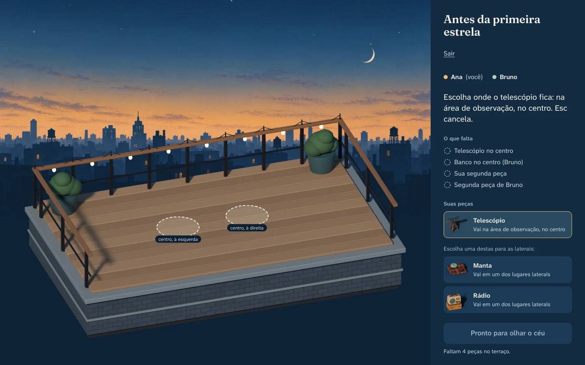
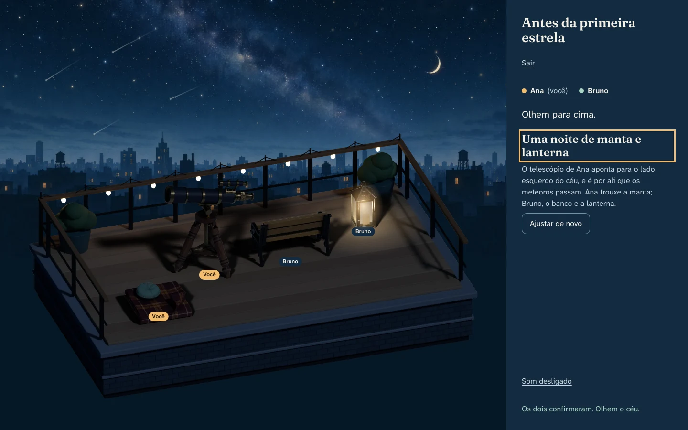
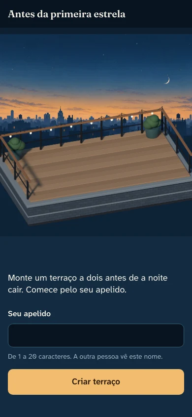
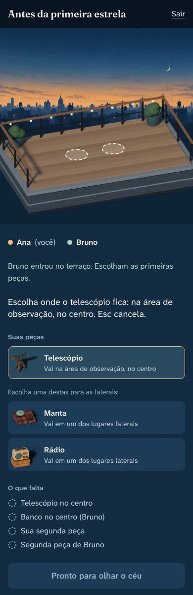
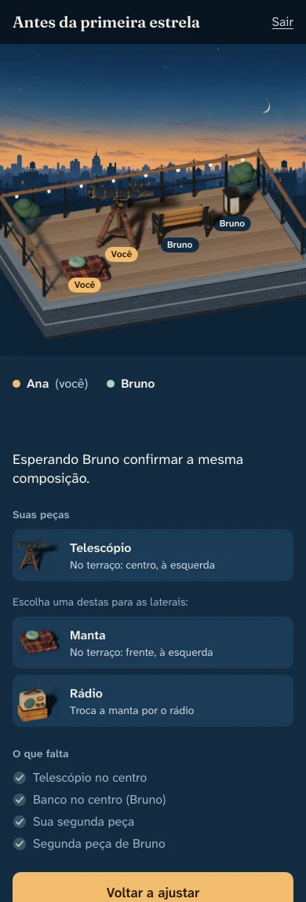
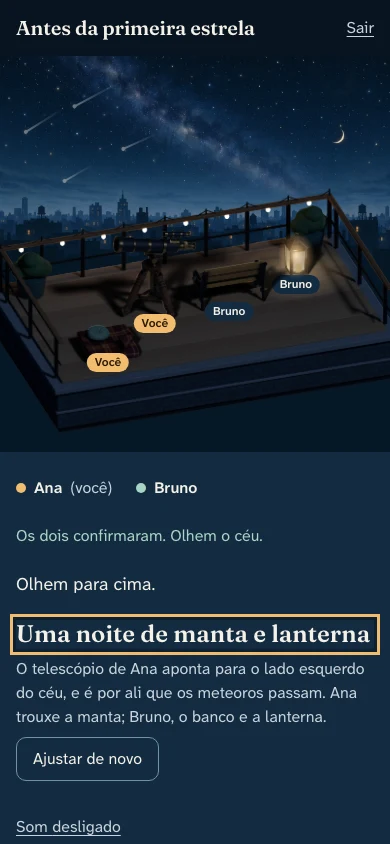

# Duora: Antes da primeira estrela

[](https://github.com/BipoXDXD/duora/actions/workflows/ci.yml)

Demonstração local para duas pessoas. Uma cria um terraço e envia o convite; a outra entra por
ele. Juntas, cada uma com as próprias peças (telescópio, manta e rádio de um lado; banco,
lanterna e garrafa térmica do outro), montam o terraço em seis lugares. Quando as duas confirmam
a mesma composição, anoitece e o céu é revelado com um resultado que depende do que cada uma
escolheu. Dá para voltar a ajustar e revelar de novo.





| Entrada | Montagem | Espera | Revelação |
|---|---|---|---|
|  |  |  |  |

## Experimentar localmente

Pré-requisitos: JDK 25. O Maven vem pelo wrapper (`./mvnw`).

```sh
./mvnw spring-boot:run
```

1. Abra <http://127.0.0.1:8080> numa janela normal, escolha um apelido e crie o terraço.
2. Copie o link do convite e abra-o numa janela anônima (ou em outro navegador): cada janela
   precisa do próprio cookie para ser uma pessoa diferente.
3. Montem o terraço e confirmem as duas.

## Testes

```sh
./mvnw verify          # formatação (Spotless), compilação com -Werror, testes de regras, API e contraste
./mvnw -Pe2e verify    # inclui as jornadas Playwright no Chromium, com capturas em target/e2e-capturas
```

Localmente, o perfil `e2e` roda no Chromium. Para outro navegador, use
`-Dnavegador=chromium|firefox|webkit`; na primeira execução, o Playwright o baixa. A CI
(`.github/workflows/ci.yml`) roda o `verify` e uma matriz e2e com os três navegadores.

## Arquitetura

- `game`: regras puras (composição, portão da primeira peça, confirmações, revelação), sem
  framework, testadas sem HTTP.
- `room`: salas em memória com lock por sala e retrato imutável para leitura, controller REST
  (`/api`), expiração por varredura agendada e respostas de erro em `application/problem+json`.
  O contrato está descrito na própria API: visão sempre do ponto de vista de quem pede, `ETag` com
  `304` no polling.
- Frontend em HTML, CSS e JavaScript nativos (`src/main/resources/static`), sem build: módulos ES,
  polling encadeado de 2 s com recuo em falhas (2, 4, 8 e 15 s).
- Segurança: credencial em cookie `HttpOnly; SameSite=Strict` (o servidor guarda só o hash),
  convite de uso único separado da credencial, mutações exigem o cabeçalho `X-Duora`, e `Origin` e
  `Host` são conferidos contra uma allowlist local (proteção contra CSRF e DNS rebinding).

## Assets

A cena é renderizada no Blender a partir de `assets/source/blender/cena.py`; os seis props vêm de
modelos gerados no Hi3D. Origem, licença e status de cada arquivo estão em
[`assets/manifest.md`](assets/manifest.md), assim como o comando para regenerar os renders. Os GLBs
originais são grandes e ficam fora do Git.

## Decisões

- Polling encadeado com `ETag` em vez de WebSocket: duas pessoas e mudanças lentas não pedem conexão aberta.
- Sem Spring Security: cookie `SameSite=Strict`, conferência de `Origin` e o cabeçalho `X-Duora` cobrem o CSRF de uma API local.
- Estado em memória: o terraço expira após 30 minutos sem ação e não precisa sobreviver a um reinício.
- Câmera ortográfica no Blender: cada prop vira um único sprite, que serve em qualquer lugar do piso sem distorção.

## Limitações

- Só roda localmente (escuta em `127.0.0.1`); não há configuração de implantação.
- O estado fica em memória: reiniciar o servidor apaga todas as salas.
- Não há contas nem histórico: a identidade é o cookie da sessão, e o terraço expira após 30
  minutos sem ação.

## Status

A demonstração está completa e testada. Faltam o aceite visual da arte e do áudio e o playtest com
duas pessoas.

## Para onde vai

A Duora vai virar uma rede social de amizade e namoro em que cenários como este terraço são o lugar
do encontro: pareamento por filtros de idade e distância, voz entre conexões mútuas e PWA instalável.
O desenho e as etapas estão em [`docs/superpowers/specs/2026-11-21-duora-social-design.md`](docs/superpowers/specs/2026-11-21-duora-social-design.md).

## Licença

- Código: licença [MIT](LICENSE), que vale só para o código.
- Assets (céu, cena, props, áudio e capturas): [Creative Commons Attribution 4.0 International
  (CC BY 4.0)](LICENSE-ASSETS), com atribuição a BipoXDXD. Origem de cada um em
  [`assets/manifest.md`](assets/manifest.md).
- Fontes: SIL Open Font License 1.1, com o texto da licença ao lado de cada arquivo em
  `src/main/resources/static/assets/fonts/`.
